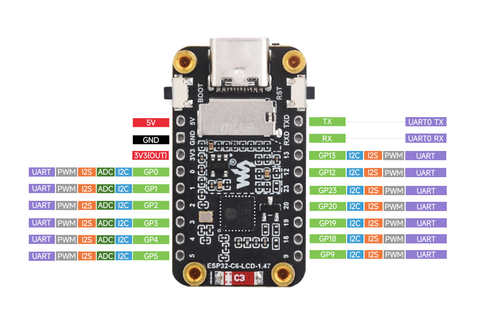
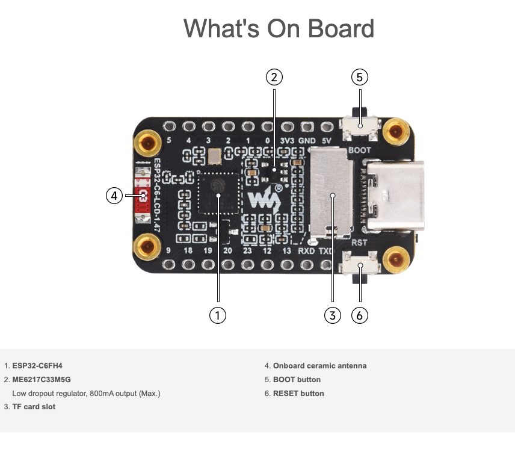

# Features

The **ESP32-C6-LCD-1.47** is a microcontroller development board with 2.4 GHz
Wi-Fi 6 and Bluetooth BLE 5 support, integrating 4 MB Flash. The onboard
1.47-inch LCD screen can smoothly run GUI programs such as LVGL. Combined with
various peripheral interfaces, it is suitable for the quick development of HMI
and other ESP32-C6 applications.

## Key features

- High-performance 32-bit RISC-V processor with clock speed up to 160 MHz, plus
  a low-power 32-bit RISC-V processor up to 20 MHz
- Integrated Wi-Fi 6, Bluetooth 5 and IEEE 802.15.4 (Zigbee 3.0 and Thread)
  wireless communication, with superior RF performance
- Built-in 320 KB ROM, 512 KB HP SRAM, 16 KB LP SRAM and 4 MB Flash memory
- Onboard 1.47-inch LCD display, 172×320 resolution, 262K colors
- Multiple IO interfaces, full-speed USB port
- Onboard TF card slot for external TF card storage of pictures or files
- Flexible clock control and multiple power modes for low-power scenarios
- Built-in RGB LED with clear acrylic sandwich panel for cool lighting effects

## Interfaces

Source: [Waveshare ESP32-C6-LCD-1.47](https://docs.waveshare.com/ESP32-C6-LCD-1.47)
